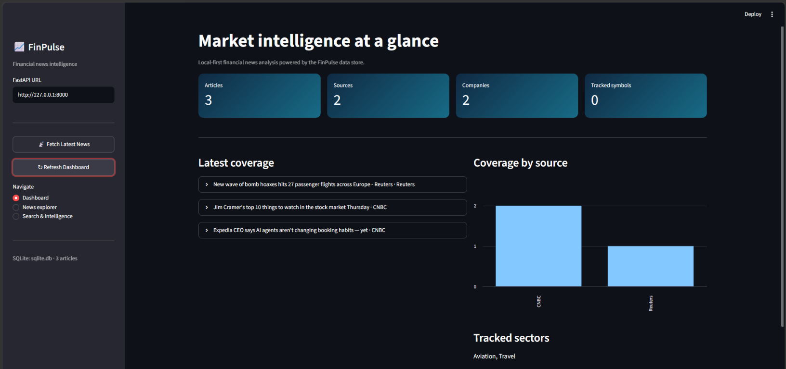

# FinPulse

FinPulse is a production-grade, multi-agent AI system that ingests real-time financial news, removes semantic duplicates, extracts market entities, and maps news events to impacted stocks with confidence scores. 

Built to solve the "information overload" problem for traders and investors, FinPulse allows users to query live financial news using natural language.

## Features

- Streamlit dashboard with:
  - article, source, company, and tracked-symbol metrics;
  - latest coverage and source charts;
  - article filtering in **News explorer**;
  - local company, sector, regulator, and keyword search.
- Persistent SQLite storage for article metadata and enrichment fields.
- Persistent ChromaDB storage for embeddings and semantic retrieval.
- LangGraph ingestion and query workflows.
- Optional Gemini-based query routing and entity extraction.
- Finnhub-based scheduled ingestion.
- Manual ingestion trigger through the API.

## Dashboard preview

The Streamlit dashboard provides a quick view of stored articles, sources,
companies, tracked symbols, and sector coverage.



## Architecture

```text
Finnhub
   |
   v
Ingestion agent
   |
   v
LangGraph ingestion workflow
   |
   +--> Deduplication --> ChromaDB embeddings
   |
   +--> Entity extraction --> Impact analysis --> SQLite article record

Streamlit dashboard
   |
   +--> SQLite (preferred)
   +--> ChromaDB fallback when SQLite has no records

FastAPI
   |
   +--> Query workflow: route query --> retrieve from SQLite/ChromaDB
   +--> Manual ingestion endpoint: POST /fetch-latest
```

## Repository layout

```text
finPulse/
├── api/
│   └── main.py                 # FastAPI application
├── data/
│   ├── sqlite.db               # Local SQLite database
│   └── chroma_db/              # Persistent ChromaDB data
├── frontend/
│   └── app.py                 # Streamlit dashboard
├── src/
│   ├── agents/
│   │   ├── deduplication.py
│   │   ├── entity_extraction.py
│   │   ├── impact_analysis.py
│   │   ├── ingestion.py
│   │   ├── querry_retrival.py
│   │   ├── query_router.py
│   │   └── storage.py
│   ├── database/
│   │   ├── chroma_client.py
│   │   └── sqlite_client.py
│   ├── graphs/
│   │   ├── ingestion_graph.py
│   │   └── query_graph.py
│   ├── schemas/
│   └── utils/
├── scheduler.py                # Runs ingestion immediately, then every 15 minutes
├── ARCHITECTURE.md
├── changed_req.txt
└── requirements.txt
```

## Requirements

- Windows, macOS, or Linux
- Python 3.11 or newer
- Internet access for the first Sentence Transformers model download
- A Finnhub API key for live ingestion
- A Google Gemini API key for Gemini-powered extraction and routing

The application can still use local query routing when `GOOGLE_API_KEY` is not
configured. Live ingestion requires `FINNHUB_API_KEY`.

## Installation

From the repository root, create and activate a virtual environment:

```powershell
python -m venv .venv
.\.venv\Scripts\Activate.ps1
python -m pip install --upgrade pip
python -m pip install -r requirements.txt
```

If PowerShell prevents activation, run the commands using the environment's
Python directly:

```powershell
.\.venv\Scripts\python.exe -m pip install -r requirements.txt
```

The repository also contains a `python3.11` environment. If that environment
is already configured, its executables can be used instead:

```powershell
.\python3.11\Scripts\python.exe -m pip install -r requirements.txt
```

## Environment variables

Create a `.env` file in the repository root. Do not commit this file.

```dotenv
FINNHUB_API_KEY=your_finnhub_key
GOOGLE_API_KEY=your_google_gemini_key
```

`FINNHUB_API_KEY` is required by `scheduler.py` and the `/fetch-latest`
endpoint. `GOOGLE_API_KEY` enables Gemini routing and entity extraction. Query
routing falls back to local rules when the Google key is absent, but the
ingestion entity-extraction agent currently expects a valid Google key.

## Start the dashboard

Run Streamlit from the repository root:

```powershell
.\.venv\Scripts\python.exe -m streamlit run frontend\app.py
```

Or, with the included environment:

```powershell
.\python3.11\Scripts\streamlit.exe run frontend\app.py
```

Open the local URL printed by Streamlit, normally
`http://localhost:8501`.

The dashboard reads SQLite first. If SQLite has no articles but the local
ChromaDB collection contains vectors, it displays ChromaDB records as a
fallback. Restart or refresh the Streamlit page after ingestion so the cached
article list is refreshed.

## Start the FastAPI service

Start the API from the repository root. Use the module path; do not run
`api\main.py` directly because the application imports packages from the
repository root.

```powershell
.\.venv\Scripts\python.exe -m uvicorn api.main:app --reload
```

Or:

```powershell
.\python3.11\Scripts\uvicorn.exe api.main:app --reload
```

The API is normally available at `http://127.0.0.1:8000`.

### Deploy on Render

Create a Render **Web Service** using the repository's `Dockerfile`. The
container starts FastAPI on Render's `$PORT` (falling back to `10000` locally),
and the health-check path is `/health`. Add `FINNHUB_API_KEY` and, when using
Gemini features, `GOOGLE_API_KEY` as Render environment variables. The
dependency list uses CPU-only PyTorch because Render's small instances do not
have GPU support and can run out of memory while installing or importing the
CUDA build.

Useful endpoints:

| Method | Endpoint | Purpose |
|---|---|---|
| GET | `/health` | Check that the API is running |
| POST | `/query` | Run the query workflow |
| POST | `/fetch-latest` | Start up to five live articles in the background |

Example requests:

```powershell
Invoke-RestMethod http://127.0.0.1:8000/health

Invoke-RestMethod `
  -Method Post `
  -Uri http://127.0.0.1:8000/query `
  -ContentType "application/json" `
  -Body '{"query":"What is happening with banking?"}'

Invoke-RestMethod `
  -Method Post `
  -Uri http://127.0.0.1:8000/fetch-latest
```

When using `/fetch-latest`, wait for the background task to finish and refresh
the dashboard. The endpoint returns before ingestion is complete.

## Run the scheduler

The scheduler initializes SQLite, fetches live news immediately, processes the
articles, and then repeats every 15 minutes:

```powershell
.\.venv\Scripts\python.exe scheduler.py
```

Or:

```powershell
.\python3.11\Scripts\python.exe scheduler.py
```

Keep this terminal running. Stop it with `Ctrl+C`. You do not need to rerun the
scheduler merely to display records already present in ChromaDB; restart or
refresh Streamlit instead. Run it when you want to fetch and process new live
news.

## Data stores

### SQLite

SQLite stores the `news_articles` table with:

- article ID, title, content, and source;
- duplicate status and canonical article ID;
- companies, sectors, regulators, and impacted stocks.

The database path is `data/sqlite.db`.

### ChromaDB

ChromaDB stores the `news_articles` collection under `data/chroma_db/`.
Embeddings are generated with `all-MiniLM-L6-v2`. The first use may download
the model.

The ingestion pipeline writes the vector before the enriched SQLite record.
If the process stops between those writes, ChromaDB can contain data while
SQLite remains empty. The dashboard handles this state with its ChromaDB
fallback, but a complete ingestion run should populate both stores.

## Development and smoke tests

Run the available test suite:

```powershell
.\.venv\Scripts\python.exe -m pytest
```

Run an individual stage smoke test:

```powershell
.\.venv\Scripts\python.exe test_stage1.py
.\.venv\Scripts\python.exe test_stage2.py
.\.venv\Scripts\python.exe stage4_test.py
```

These scripts may write to the local SQLite and ChromaDB files. Back up or
clear local development data before testing from a clean state.

## Troubleshooting

### Dashboard shows zero articles

1. Confirm that Streamlit is running from the repository root.
2. Check the database:

   ```powershell
   .\python3.11\Scripts\python.exe -c "import sqlite3; c=sqlite3.connect(r'data\sqlite.db'); print(c.execute('select count(*) from news_articles').fetchone())"
   ```

3. Check ChromaDB:

   ```powershell
   .\python3.11\Scripts\python.exe -c "from src.database.chroma_client import news_collection; print(news_collection.count())"
   ```

4. Refresh the Streamlit page. The dashboard cache lasts up to 30 seconds.
5. If both stores are empty, configure `FINNHUB_API_KEY` and run the
   scheduler or call `/fetch-latest`.

### `python api\main.py` fails

Start the app with Uvicorn instead:

```powershell
.\python3.11\Scripts\uvicorn.exe api.main:app --reload
```

### Live ingestion fails

- Verify `FINNHUB_API_KEY` exists in `.env`.
- Verify that the machine has internet access.
- Check the scheduler/API terminal for the upstream response or pipeline
  error.
- Verify `GOOGLE_API_KEY` if entity extraction fails.

### ChromaDB duplicate ID errors

The smoke tests can attempt to insert an existing vector ID when run more than
once. Use a clean local ChromaDB directory only when you are certain that
discarding local development data is acceptable.

## Data and secrets

`data/sqlite.db` and `data/chroma_db/` are local development state. They can
be regenerated and should not be treated as portable production data. Keep API
keys and other secrets in `.env`, never in source code or committed files.

## Contributing

1. Create a focused branch.
2. Keep processing logic in `src/`.
3. Expose API behavior through `api/` and UI behavior through `frontend/`.
4. Add or update tests with behavioral changes.
5. Update `ARCHITECTURE.md` when data flow or component boundaries change.
6. Run the relevant tests before opening a pull request.
